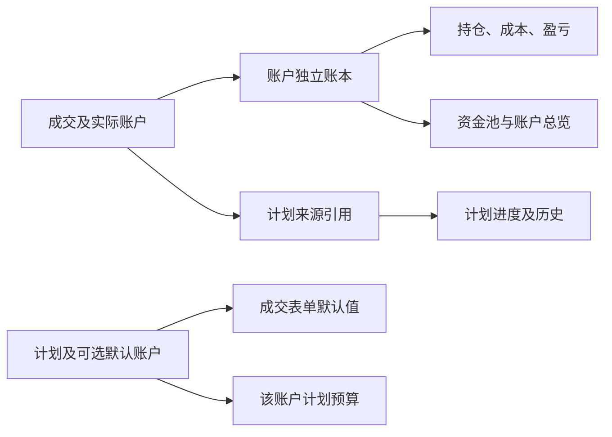

# 账户归属重构设计

日期：2026-10-12。业务规则已由用户确认。本设计对应当前实现。

## 业务规则

1. 账户表示实际成交归属。持仓、成本、盈亏、资金池与账户总览统一从真实账本推导。
2. 计划可选择默认执行账户，成交时可更换，同一计划可跨账户分批成交。每次成交记录实际执行账户。
3. 待确认仅容纳缺少可靠归属的旧成交。明确原始账户且可安全归类的记录可修复；无法确定的保留待确认。
4. 成交展示与持仓账户筛选独立。成交列表、计划成交历史、日 K 的 B/S 均包含全部账户。

## 模型与边界

| 信息 | 权威来源 | 职责 |
| --- | --- | --- |
| 实际账户 | 成交所在独立交易账本；新成交账户字段与其一致 | 持仓、成本、盈亏及成交编辑 |
| 默认执行账户 | `TradePlan.executionAccountID`，可为空或为命名账户 | 表单默认值、计划预算 |
| 计划引用 | 成交的计划 ID 与 `sourceAccountID` | 关联原计划、计算跨账户成交进度 |
| 旧份额标签 | 历史 `PositionPortion.brokerageAccountID` | 保留历史兼容证据，不参与账户统计或写入 |
| 待确认历史 | 兼容 `unassigned` 存储 | 保存缺可靠归属的旧记录、提供归类入口 |

计划通过全账户投影统一呈现，保留原存储命名空间以兼容同步、提醒与历史引用。来源账户是内部记录身份，界面不把它显示成执行账户。没有必要为了改变存储形状而搬移全部计划。

## 实现

### 统一读写入口

`BrokerageOwnership` 集中目的账户、资金方式、计划引用和归类规则。普通买入、普通卖出与计划成交采用有校验的新记录入口；旧 `addTransaction` 保留为低层历史导入/兼容入口，生产界面和 MCP 的多账户新记录不调用它。

新计划成交保存明确来源账户，包括同账户成交。默认执行账户进入计划修订和成交时配置快照，实际成交账户独立保存。同步版本为 18，归档版本为 16；没有新字段的旧数据继续声明其原最低版本。

旧 `filledTransactionID` 仅关联没有执行引用的成交；显式执行引用优先。旧成交和新成交可以共同计算进度。归类不发明旧成交当时的计划快照。

### 原子归类与纠错

所选成交模式保留来源计划和目标已有资料；选择所有成交或最后一笔仍然是成交模式。整体模式同时搬移该标的资料，并更新其他账户中指向其计划的引用；目标已有冲突资料时拒绝整体模式。

所有操作先构造完整候选快照，校验交易顺序、数量、份额、资金方式、存储结构与计划进度，再提交。计划按原账户、标的、计划 ID 配对，避免相同 UUID 的不同计划混计。成交 ID、价格、数量、日期、费用、资金方式与原配置保持；实际账户及必要的来源引用按归类结果更新。

归类也校验仍有效的份额绑定卖出计划。部分归类不能留下失效的绑定；整体搬移时，绑定计划的当前默认执行账户随实际份额移动，并保留原配置修订。

融资记录不能归入不支持融资的账户。失败时所有账户保持原样。归类是本地记录归属纠正，不生成证券转账或新的成交。

### 可靠旧记录修复

只扫描待确认账本中原始成交已经明确命名账户的记录，按标的及目的账户分组，复用所选成交的完整校验。涉及依赖买卖、份额待核对或其他不能安全拆分的组保留待确认。卡片标签不用于猜账户。

应用启动先保存并读回验证完整备份，再尝试可靠修复；备份失败不进行归类。操作恢复原账户选择并保持幂等。

### 卖出边界

未绑定份额的卖出计划可选择有实际持仓的命名账户。份额候选、数量与版本检查均读实际执行账本。绑定具体份额的计划锁定该份额账户，不能借用另一账户同 ID 的卡片。失败时计划和目标账本均不改变。

### 旧档案导入

单账户可移植档案继续校验账户范围。没有账户范围的旧档案导入命名账户时，明确的旧计划来源命名空间随导入重定位，保留成交进度。发现成交已存在于另一账户或另一标的、明确成交账户与目标冲突，或融资方式不兼容时，在任何写入前拒绝。重新导入同账户同标的的记录仍保持幂等。

## 界面

- 计划编辑新增可选默认执行账户；空值显示“成交时选择”。历史默认值保持原样，用户可以修改或清空。
- 成交表单显示实际执行账户；成功后页面跟随该账户。计划行列出所有真实成交账户，支持跨账户分批记录。
- 主窗口、菜单栏、悬浮详情、成交列表与复盘跨账户显示成交；持仓继续按实际账本查看。
- 卡片账户为只读实际归属。成交记录可打开“修改账户归属”，复用已备份的归类流程。
- 总览、资金池与预算预演统一按默认执行账户预算；未选默认账户的计划有提示，并暂不计入账户预算。
- 份额核对及资金方式表单使用冻结的实际账户，历史卡片标签不改变操作对象。

## 分工与验收

Flash 开发代理按文件所有权完成模型与存储兼容、核心流程、持仓界面、计划界面及旧数据测试。主代理设计、补充独立反例、审查并修正集成问题，负责完整回归、稳定签名构建、原生虚构数据与实际按钮验收。

核心验收覆盖跨账户分批买卖、旧 ID 与新成交共存、同 UUID 不同来源、部分/整体归类、最后一笔、融资限制、旧标签不影响统计、可靠修复及失败原子性、预算账户和版本兼容。原生验收覆盖成交 B/S、计划默认账户、实际保存按钮、账户总览、资金池及预算预演。

全部开发测试采用虚构隔离数据，不向开发代理发送真实账户或凭据。完整 Core 验收通过 55 项 XCTest 与 915 项 Swift Testing；原生计划验收通过 112 项检查，并验证成交展示、账户总览与资金池。通过稳定签名构建后已更新日常应用。用户追加要求提交并推送；不创建正式发布版本。
