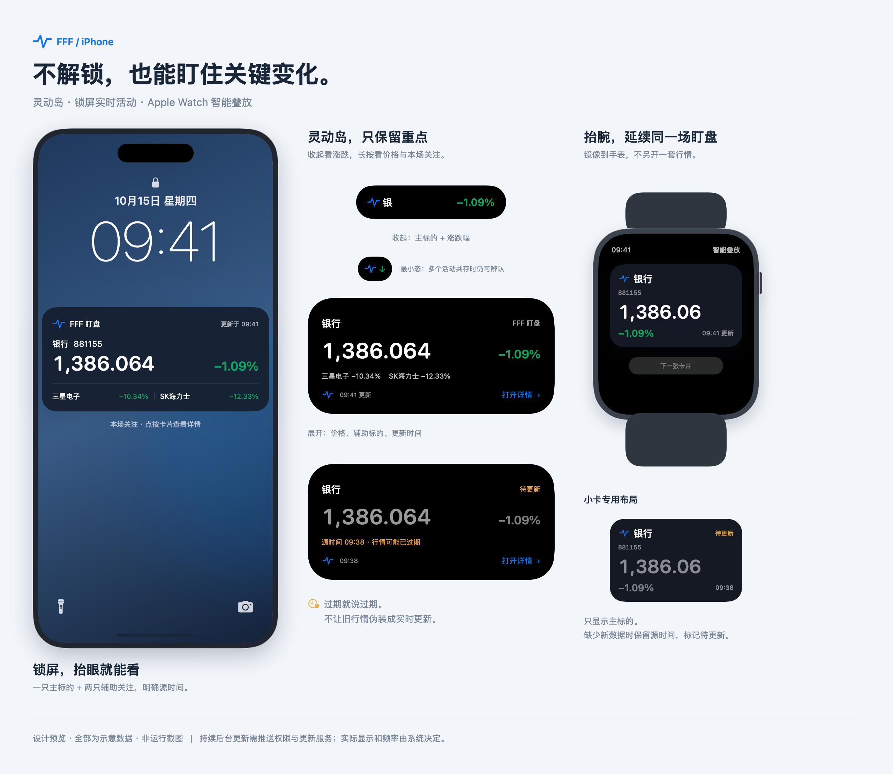
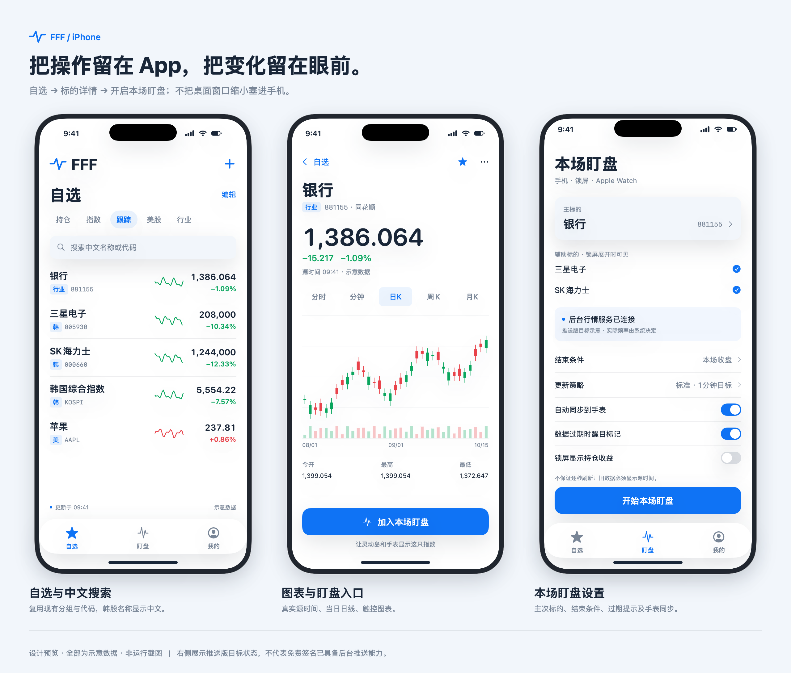

# FFF iPhone 私人版开发方案

> 此为已被替代的 v1 讨论稿。用户否定了每日手动开启和只读行情定位，后续请以[工作台方案 v2](../iphone-plan-2026-10-16/README.md)为准；本稿保留仅作历史对照。

**设计重点：灵动岛、锁屏实时活动、Apple Watch 智能叠放。**

版本：方案稿 v1 · 2026-10-15。本文不是已实现功能清单；预览图是精确排版的概念稿，所有行情与账户数字均为示意，不是运行截图或实时行情。当前日用 Mac 应用不因本方案而改变。

## 先说结论

推荐做一个「随身盯盘伴侣」，而不是把桌面窗口缩小。App 内负责选标的、看图表、开启一场盯盘；灵动岛、锁屏和手表负责让你少解锁、少切 App。

**自动续签、自动数据同步、锁屏持续行情更新，是三件不同的事。** 免费账号可以解决自用安装和本地体验，但不能据此承诺锁屏后仍持续更新行情。真正满足长时间锁屏盯盘，应按付费开发者签名、ActivityKit 推送和常在线行情更新服务规划；仍然不必上 App Store。

## 预览图

### 核心体验：锁屏 → 灵动岛 → Apple Watch

### App 内：自选 → 详情 → 本场盯盘

预览里「后台行情服务已连接」是**推送版目标状态**，不是免费签名已经具有远程推送能力的宣称。手机和手表的布局尺寸由实际机型与系统决定，开工后需做真机校验。

## 一、首版主要完成什么

| 功能 | 首版交付 | 明确边界 |
|---|---|---|
| 自选分组 | 新增、删除、排序、分组；沿用持仓/指数/跟踪/美股/行业的习惯 | 手机上编辑的是本地自选，首版不自动回写 Mac |
| 中文搜索 | 中文名、别名、完整代码；三星电子、SK海力士、银行行业指数、KOSPI | 市场与完整代码共同识别，同码 A 股不能误匹配 |
| 行情列表 | 最新价、涨跌幅、迷你分时、市场状态、来源和源时间 | 不把收到数据的时间冒充行情源时间；指数用点数、股票保留币种 |
| 标的详情 | 分时、日/周/月K；数据源可靠时提供分钟K；基础统计 | 同花顺分钟K可能滞后，必须显式提示，不能用分时采样伪造真实 OHLC |
| 本场盯盘 | 选一只主标的、最多两只辅助标的；手动开始、结束、看状态 | 一场活动集中看重点，不为每只股票各开一张活动卡 |
| 灵动岛 | 收起、最小、展开三态；展示价格/涨跌与新鲜度 | 主标的固定，不自动偷偷轮播，防止把甲的涨跌误看成乙 |
| 锁屏实时活动 | 主标的大价格、辅助涨跌、来源更新时间、过期/收盘状态 | 只显示公开行情，不默认显示持仓金额、收益、账户名 |
| Apple Watch | 同一场活动镜像到智能叠放，提供专用小尺寸布局 | 不是独立手表行情客户端，也不是表盘常驻复杂功能 |
| 数据导入与设置 | 从 Mac 导入自选快照，导入前预览；来源开关、红涨绿跌、隐私说明 | 不同步密钥；首版不做券商交易、账本双向编辑和自动交易 |

**持仓速览的安排：** 可以作为后续小版本导入 Mac 持仓快照并只读展示。必须显示快照时间、账户范围、币种与汇率时间；缺少汇率时不把多币种金额直接相加。它不应挤占第一版灵动岛/锁屏/手表的真机验证时间。

## 二、信息架构与手机交互

底部只留「自选 / 盯盘 / 我的」三栏。

- **自选：** 最近使用的分组置顶；搜索在单手可达区域；一行清楚显示中文名、市场、代码、价格、涨跌。点行看详情，长按调顺序，左滑删除。
- **详情：** 报价与真实源时间在上方；图表占中部；底部主动作是「加入本场盯盘」。横向拖动查看历史，双指缩放，长按显示十字线与 OHLC，不照搬鼠标 hover/滚轮。
- **盯盘：** 当前活动状态、主标的和辅助标的、活动截止时间、更新服务连接状态、锁屏与手表设置。未配置推送时明确显示「本地体验模式」，不写「后台实时」。
- **我的：** 导入/导出、行情源、数据新鲜度、颜色方案、隐私、安装/续签帮助；免费安装状态与后台推送状态分开显示。

不提供买卖下单按钮，不索取交易密码。股票价格、指数点数和加密货币报价各自格式化，不能一律加人民币符号。

## 三、灵动岛重点设计

### 1. 收起态：只放最重要的信息

左边是 FFF 蓝色波形与主标的短名，右边是涨跌幅。示例：左「银」，右「−1.09%」。传感器区域留空，内容不跨到摄像头中间；不把股票代码、完整价格、三个标的一次全塞进收起态。

### 2. 最小态：多活动共存时仍可辨认

只保留简洁品牌标识与涨跌/状态提示。不可把最小态当成总能读出完整报价的空间，切换到其他活动时不得继续假定 FFF 占据整个灵动岛。

### 3. 展开态：一眼看懂本场关注

主区域是中文标的名、价格和涨跌幅；下方最多两只辅助标的；始终保留源更新时间。点按跳到对应详情。第一版不承诺通过卡片按钮直接强制系统立刻联网刷新。

### 4. 新鲜度比动画更重要

同一份展示状态贯穿手机、锁屏和手表：

| 状态 | 显示方式 | 系统行为 |
|---|---|---|
| 等待首笔数据 | 显示「等待行情」，没有旧价格就不填假数 | 首笔有效数据到达才显示价格 |
| 正常跟踪 | 价格/涨跌正常显示，标注源时间 | 源时效与推送预算允许时合并更新 |
| 数据过期 | 价格弱化，醒目显示「待更新」和最后源时间 | 使用 staleDate，让系统在后续推送没来时也能显示过期态 |
| 源异常或服务离线 | 显示「更新服务离线/数据源异常」，保留最后有效值 | 不把旧数值重新打上当前时间 |
| 午休/休市 | 显示「午间休市/已收盘」 | 不把正常休市当成故障 |
| 本场结束 | 显示结束摘要并停止刷新 | 默认短暂保留收盘摘要，再按系统策略移除 |

过期阈值按数据源已知延迟、目标刷新周期及交易时段计算，而不是所有市场统一「超过一分钟就错」。已知延时源必须显示延时，不能因为刚收到一笔旧行情就亮「实时」标记。

## 四、锁屏实时活动卡片

锁屏卡采用主次分明的布局：

- 上行：FFF 标识、本场状态、最后更新时间。
- 主体：一只主标的、大号价格和涨跌幅。
- 下行：最多两只辅助标的，主要显示名称和涨跌幅；空间不足优先减少字段，不缩成不可读小字。
- 点击：打开该场活动的主标的详情；结束可在 App 或系统允许的交互中完成。

**默认隐私：** 不显示持仓数量、成本、收益或账户余额。后续若允许打开这类信息，必须由用户主动开启，并结合系统隐私敏感内容遮蔽；不能假定锁屏卡仅本人可见。

**活动是「一场盯盘」，不是永久驻留控件。** 按当前 Apple 文档，Live Activity 活跃期最长约 8 小时，结束后锁屏摘要最多可再保留 4 小时。A 股、韩股或美股常规单场可以单独管理；全天加密货币或美股盘前到盘后不能承诺一张卡永久续命，接近系统上限时应明确提示重新开启一场。

## 五、Apple Watch 智能叠放小卡

### 首版采用镜像，不另做一整套手表 App

在兼容的 iPhone 与 Apple Watch 系统组合上，iPhone Live Activity 可以自动出现在手表智能叠放中。推荐按 **iOS 18+ 与 watchOS 11+** 作为本方案完整体验的起点，并在开工前确认你的实际机型、系统和镜像设置。iOS 17 的基础手机/锁屏支持可作为降级路径，不把手表镜像当成该组合的必达项。

在 iPhone 的 Widget 扩展中提供小尺寸活动布局，使用 supplemental activity family 与 activityFamily 适配；不依赖把整个锁屏卡硬缩小。首版无需为了镜像额外开发一个完整 watchOS 行情客户端。

### 小卡只回答四个问题

1. 我现在盯哪只：中文短名＋代码。
2. 当前显示的价格/指数点位是多少。
3. 相对前收涨跌多少。
4. 这笔数据是什么时间的，是否已过期。

示例小卡：银行 · 881155 / 1,386.06 / −1.09% / 09:41 更新。三只标的不要挤进同一张手表小卡；主标的与手机灵动岛一致。

### 必须设计的异常与边界

- 用户关闭手表镜像、系统未允许显示时，App 明确说明；App 的「同步到手表」开关不能越过系统权限。
- 断网或镜像更新中断时，价格保留源时间并变为「待更新」，不能做假实时动画。
- 手表端是同一活动的镜像，不等于手表独立联网获取行情；不承诺离开 iPhone 后仍持续独立更新。
- 点按按系统支持进入活动详情或接力；在未做独立 watchOS App 前，不承诺点击就能启动完整的手表 K 线页。
- 智能叠放卡与表盘复杂功能不同。「表盘常驻报价」是后续独立需求，WidgetKit/系统刷新预算也不能保证逐秒行情。

## 六、真正锁屏持续更新，需要怎样的方案

| 模式 | 可做什么 | 无法保证什么 | 安装/依赖 |
|---|---|---|---|
| A：免费本地体验 | App 前台取行情、创建/更新本地活动、体验锁屏/灵动岛；兼容性允许时测试手表镜像 | App 被挂起后持续联网轮询、长期锁屏自动收到新行情 | 免费个人签名＋自动续签工具；具体扩展签名与镜像能力先真机验证 |
| B：正式私人盯盘版（推荐目标） | 常在线行情服务取数，ActivityKit/APNs 更新活动，锁屏与手表跟随同一场盯盘 | 逐秒刷新、固定推送到达时间、后台永不被限流 | 按付费开发者账号、推送权限和常在线服务规划；无需上架 |

推荐先用小型真机验证做 A，确认实际设备能显示各形态；**如果你的核心目的是锁屏/抬腕持续盯盘，最终交付目标应为 B，不把 A 冒充已满足需求。**

后台数据链路：行情数据源 → 常在线更新服务 → Apple APNs → iPhone Live Activity → 系统镜像到 Apple Watch。活动视图本身不能直接联网抓行情；普通 Widget 时间线刷新也不是每秒执行的定时器。

更新策略初稿：标准模式以约一分钟为目标，重要变化合并推送；更高频档位仅在权限、源时效和系统预算允许时提供，不作固定周期承诺。不能把每次价格变动都当高优先级通知，也不重复发送普通通知轰炸用户。

### 三类连接不要混淆

| 通道 | 用途 | Mac不在线的影响 |
|---|---|---|
| AltServer/免费续签 | 延续 App 的可运行签名 | 长期不可达可能使签名过期，App 无法打开 |
| Mac快照导入 | 把自选/可选持仓副本带到手机 | 导入副本仍可用，行情由手机独立联网获取 |
| 后台行情更新服务 | 锁屏后仍有新的活动内容 | 若服务部署在你的 Mac，Mac 休眠/关机就停止更新；若部署到常在线云端则不依赖 Mac 开机 |

初期服务可用一台常开的 Mac 验证；若你经常外出、Mac 会休眠，应选择常在线服务。部署方式需要确认，但方案不要求公开任何持仓或开放 Mac 的现有 MCP 控制端口。推送凭据由你在本机配置，不能写入安装包、预览图或文档。

## 七、复用现有系统的方式

| 现有模块 | 复用内容 | 需要补的工作 |
|---|---|---|
| [PulseCore](../../Packages/PulseCore/Package.swift#L6) | SymbolID、行情源、CompositeProvider、中文名、交易日历、持仓模型、历史数据解析 | 真机网络与前后台生命周期，隔离不可用的桌面依赖 |
| [PulseUI](../../Packages/PulseUI/Package.swift#L6) | 分时/K线、格式化、红涨绿跌、部分行情组件 | 手势、触控命中区域、手机宽度与字体，不能把桌面 hover/滚轮当手机交互 |
| [现有同步快照](../../Packages/PulseCore/Sources/PulseCore/Store/WatchlistSyncSnapshot.swift) | 账户/自选/分组数据结构及合并语义 | 首版先做受控单向导入；自动双向同步和冲突操作后置 |
| 长桥连接层 | 路由、symbol映射、部分状态语义 | [当前Mac SDK加载](../../Packages/PulseCore/Sources/PulseCore/Providers/Longbridge/LongbridgeSDKBridge.swift#L297)不能原样搬到手机；独立验证iOS SDK与授权流程，首版可先用现有HTTP行情源 |

工程建议新增 iPhone 应用目标和 Live Activity/Widget 扩展；Activity 的 attributes/content state 放在共享小模块中，让 App、扩展和推送服务使用相同字段。首版不需要单独 watchOS 应用目标，除非真机验证发现镜像不能满足交互要求。

活动载荷只带本场标的、公开价格/涨跌、状态、源时间和结束时间；不携带完整自选、账户账本和凭据。Apple 当前规定活动动态/静态数据合计需控制在约 4 KB 内，多标的卡片必须保持精简。推送令牌会变化，服务端需处理轮换、失效和停止跟踪后的撤销。

## 八、开发顺序与工程量

下列是熟悉现有工程的一名开发者集中投入的粗估，包含基本真机检查，不是交付日期承诺。新增灵动岛/手表/远程更新后，工作量明显高于之前只做行情列表的版本。

| 阶段 | 工作 | 验收后才进入下一阶段 | 粗估 |
|---|---|---|---|
| G0：可行性闸门 | 建iPhone和Widget目标、隔离Mac依赖、真机签名、锁屏/灵动岛/手表镜像最小验证、APNs小实验 | 确认你的设备和签名路径可行，免费/推送模式差异可见 | 2–4人日 |
| G1：手机基本盘 | 自选、中文搜索、行情详情、触控图表、缓存、空态和源时间 | 手机独立看行情，无Mac运行依赖 | 7–12人日 |
| G2：重点盯盘 | 单场活动生命周期、各形态、Watch小卡、过期态、行情服务、APNs和结束清理 | 锁屏后能按实际推送更新；断网不伪装实时 | 7–12人日 |
| G3：个人可日用 | Mac快照导入、隐私、安装续签说明、耗电与异常回归 | 重装覆盖不丢数据、长时间真机试用稳定 | 4–7人日 |

完整私人盯盘目标约 **20–35人日，日历约4–7周**，还取决于开发者账号权限、实际设备、SDK和常在线服务准备情况。不包含注册/付费等待、商店审核、独立watchOS行情App或复杂账本双向编辑。免费本地体验版可先行，但不能当作完成了锁屏持续盯盘。

## 九、验收清单

### 功能正确

- 中文搜「三星」「海力士」「银行」「韩国股指」命中正确市场，不混成同码A股/ETF。
- 日线包含真实当天官方 OHLCV，不能复制昨日、修改日期充数；分钟历史过期明确提示。
- 已有自选和代码标识不因显示名翻译而改变；手机快照导入前可预览、可取消、失败不覆盖本地。
- 点详情开启盯盘后，锁屏、灵动岛和手表指向同一主标的，不出现价格和名称错位。

### Live Activity 与手表

- 真机覆盖灵动岛收起/最小/展开、锁屏、不同手表屏幕；无灵动岛机型有锁屏降级。
- 手机锁屏一段时间，推送仍能更新；记录真实源时间、发送和显示时间，不仅验证App在前台。
- 切飞行模式、关闭更新服务、故意不给后续推送，过期状态自动出现，数值不假装刷新。
- 结束活动、收盘、达到系统最长时限、令牌轮换都能正确停止与清理。
- 验证手表镜像开/关、手表暂离线、抬腕查看；不把系统未展示误报为同步成功。
- 免费签名与付费推送分别真机测试，不能用模拟器显示成功替代权限和长期后台验收。

### 数据、续签与隐私

- 覆盖安装/续签保持应用标识，不先删除App；有本地导出备份与导入回滚。
- 锁屏默认没有持仓收益等敏感字段；推送载荷不含账户数据或密钥。
- 连续盯一场的耗电和网络调用量可解释；不承诺锁屏逐秒报价或后台永远常驻。

## 十、后续再做什么

第二阶段再考虑自动Mac双向同步、持仓记账编辑、计划/复盘、完整长桥登录、小组件与表盘复杂功能。若你明确需要Apple Watch离开iPhone后独立看行情，再新增watchOS App，这与智能叠放镜像是另一项工程。

第一版明确不做自动交易、券商下单、社交资讯流、云端存完整账户、后台无间断轮询和永久实时卡片。

## 开工前仅需确认的事项

你的 iPhone 型号/iOS、Apple Watch 型号/watchOS；是否愿意为后台推送使用付费开发者账号；后台更新服务用常开Mac还是常在线服务。除此之外，已有Mac日用版本和账户数据不应先被改动。

## 官方依据与限制核对

资料核对日期：2026-10-15。系统策略可能变化，G0阶段仍须用目标设备实测。

- [ActivityKit：显示实时活动](https://developer.apple.com/documentation/activitykit/displaying-live-data-with-live-activities)：活动视图不能自行联网、生命周期和载荷限制。
- [ActivityKit：通过推送开始和更新](https://developer.apple.com/documentation/activitykit/starting-and-updating-live-activities-with-activitykit-push-notifications)：APNs服务、令牌轮换、stale date、系统更新预算。
- [自定义活动视图与跨设备小尺寸布局](https://developer.apple.com/documentation/activitykit/creating-custom-views-for-live-activities)：Apple Watch智能叠放及小尺寸适配。
- [supplementalActivityFamilies](https://developer.apple.com/documentation/swiftui/widgetconfiguration/supplementalactivityfamilies(_:))：自定义附加family接口的iOS 18起点。
- [Apple HIG：Live Activities](https://developer.apple.com/design/human-interface-guidelines/live-activities)：简洁布局、单活动管理相关关注、隐私与结束摘要。
- [Apple账户与个人装机](https://developer.apple.com/help/account/basics/about-your-developer-account)、[计划费用](https://developer.apple.com/programs/enroll/)：免费个人签名与付费开发者会员是不同方案，不必公开上架。
- [AltServer](https://faq.altstore.io/altstore-classic/altserver.md)、[AltStore刷新](https://faq.altstore.io/altstore-classic/your-altstore.md)：同网/USB、电脑在线与后台尝试刷新；不能承诺无条件无感续签。
