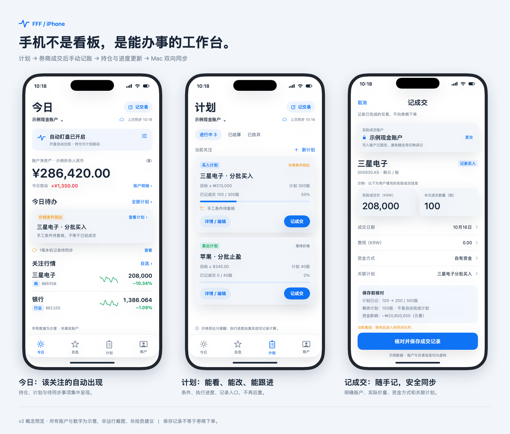
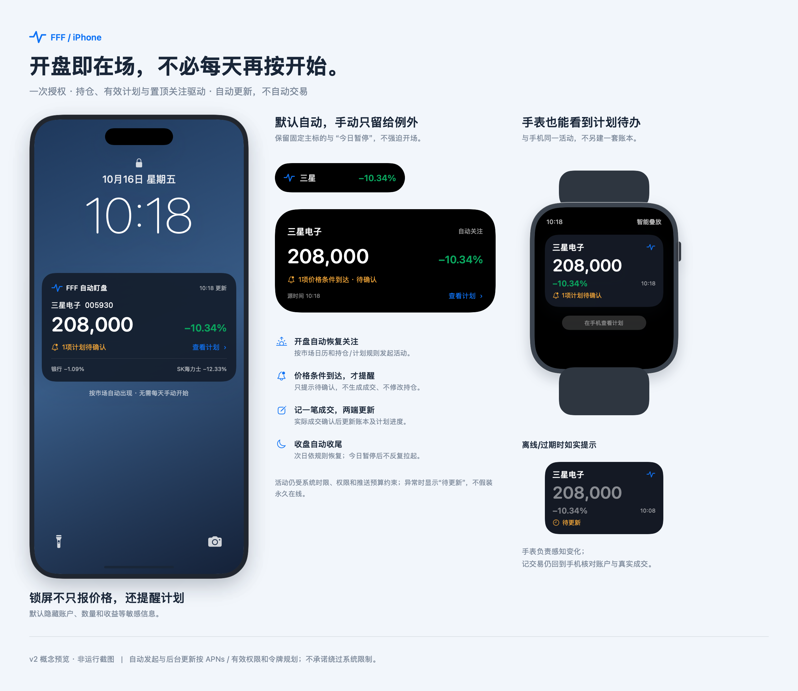

# FFF iPhone 工作台方案 v2

**定位修正：不是临时看行情的伴侣，而是你离开 Mac 后仍能继续做事的工作台。**

2026-10-16。此方案替代前一版「本场盯盘」方案。下列是开发目标，不是已经实现的 iPhone 功能；预览为原生排版概念图，账户和数字均为虚构示意，不是运行截图、不是交易建议。未改动当前 Mac 日用应用或用户账本。

## 一、先纠正上一版的方向

上版做错的不是按钮名称，而是产品定位：

- 把应当持续保存的「关注状态」设计成每天手工发起的临时会话。
- 把计划、持仓、记成交与双向同步后置，删掉了计划→实际成交后记录→复盘的核心闭环。
- 围绕灵动岛做漂亮展示，却没解决手机上真正要办的事。

新版原则：**首次授权和设置一次，日常按规则自动在场；计划和记成交属于首个可日用版本，不再后置。** 灵动岛、锁屏和手表是工作台的低打扰出口，不是整个 App 的中心流程。

已按用户许可咨询 Kimi K3 做一次独立产品评审；最终方案由主代理结合真实模型与安全约束审定。评审采纳与修正见[评审说明](review-notes.md)。

## 二、首个可日用版本必须具备的功能

| 模块 | 首版必须能做 | 不能偷换的含义 |
|---|---|---|
| 账户与持仓 | 按账户看持仓、现金/融资、成本、已实现/未实现盈亏；继承现有资金与持仓池规则 | 账户不能混算；缺汇率不拼一个假总额；融资限制不能由新UI绕过 |
| 自选与行情 | 原有分组、排序、中文名与完整代码搜索、分时和K线、行情源/时效 | 银行行业指数、三星电子、SK海力士等身份与Mac一致；指数不能当股票记仓 |
| 买卖计划 | 查看、创建、修改、备注、手工条件、执行账户意向、资金方式、持仓池、变更历史 | 计划是意图；到价不是成交；手工条件不由系统擅自确认 |
| 计划执行 | 查看待执行/部分成交/已成交，以及停止、放弃、恢复；分批记录实际成交 | 执行数量从关联成交记录计算，不能用一个“已完成”开关冒充成交 |
| 随手记交易 | 全局「记交易」入口；也可从持仓/计划带上下文进入；买、卖、费用、实际账户、资金方式、日期、关联计划 | 是手动记已发生的成交，不是券商下单，也不自动交易 |
| 流水与复盘 | 按账户/标的/日期查成交、修改纠错、受控删除、补录历史、简短复盘 | 修改和删除前展示影响，遵守原始记录/账户及账本重放校验 |
| Mac双向协同 | 计划、成交、持仓与分组自动同步；离线本地保存、待同步队列、冲突提示 | 不是每次导出导入；也不静默覆盖另一端记录 |
| 自动关注 | 根据持仓、有效计划、置顶关注及市场日历，自动选择关注内容并尝试自动出现活动 | 不是要求用户每天点“开始”；也不承诺绕过系统和权限限制 |
| 灵动岛/锁屏/Watch | 报价＋精简计划待办＋真实源时间；专用Watch小卡；过期/休市/暂停状态 | 不把镜像说成独立手表App，不让旧行情伪装实时 |

合理后置的是高级图表形态、复杂策略图、独立手表交易工作台、资讯社区和自动券商下单，不是计划/记账/双向同步这些基本功能。首版不做实际券商下单或自动交易。

## 三、界面与最短操作路径

底部改为 **今日 / 自选 / 计划 / 账户**。保留独立自选入口，符合现有跟踪习惯，不因为增加计划而把自选藏起来。

| 入口 | 日常看到什么 | 最重要动作 |
|---|---|---|
| 今日 | 当前账户概览、计划待办、自动关注状态、待同步/冲突事项 | 一步进计划；全局记交易 |
| 自选 | 持仓/指数/跟踪/美股/行业等分组，行情与图表 | 搜索、关注、固定主标的；详情内也能看计划/记成交 |
| 计划 | 跨标的计划列表，按账户筛选；价格条件、手工条件、执行进度、历史 | 新建/编辑/停止/放弃/恢复；记录成交或受控补录 |
| 账户 | 持仓、资金、账户规则；账户内「持仓 / 流水 / 复盘」切换 | 查账、纠错、资金与持仓核对；设置放二级入口 |

「记交易」不是独立占一个底栏，而是所有主页面可达的固定动作。这样既保留自选，也不会让成交入口藏到多级菜单。

### 路径A：看/改计划

今日待办或计划页 → 查看价格条件、手工条件与执行进度 → 编辑意图 → 保存并同步 → 两端保留同一计划ID和变更历史。

改变目标价格或数量，不倒改历史成交快照；已经记录的实际成交事实不能被后续计划修改重写。

### 路径B：券商成交后随手记一笔

在券商完成实际成交 → 回FFF「记交易」或从相关计划「记成交」进入 → 核对实际成交账户 → 填真实成交价/数量/日期与费用 → 预览资金、持仓和计划进度变化 → 保存 → 本机立即可见、联网自动同步到Mac。

**不默认拿计划价或当前行情价填成实际成交价。** 可以显示参考价，但真实成交价必须由用户输入或明确确认；数量可带出剩余计划供参考，仍需确认本次实际成交量。

### 路径C：不做准备也能查看关注

持久保存的关注规则 → 市场开盘且有相关持仓、有效计划或置顶 → 服务按授权尝试远程发起活动 → 锁屏/灵动岛/手表自动呈现 → 只在例外时需要「今日暂停」「更换固定主标的」或恢复权限。

## 四、自动盯盘的正确默认

### 首次设置一次，而不是每天开场

首次需要确认关注的账户/市场、自动关注开关、活动/通知权限，以及是否允许锁屏显示精简计划提醒。默认候选来自 **持仓或有效计划或置顶关注**，不是三者必须同时存在。

配置是持久偏好，底层Live Activity才是有生命周期的系统对象。**系统对象结束，不应等于你的关注偏好被清空。**

正式自动模式使用 ActivityKit push-to-start 与 APNs，服务按市场日历和已有授权发起；不是靠iPhone在后台不停跑定时器。开盘时无需每天先打开App，但前提是签名有效、权限与令牌有效、服务可达且系统接纳该推送。

### 默认行为矩阵

| 情形 | 正常行为 | 是否每天手动操作 |
|---|---|---|
| 开盘且有持仓/计划/置顶 | 按已授权规则自动尝试出现活动，取最新状态 | 不需要每天开始 |
| 午休或休市 | 显示明确市场状态，降低更新频率或自动收尾 | 不需要 |
| 计划价格条件到达 | 精简提醒「待确认」，能跳回计划；手工条件不自动完成 | 不需要先重选主辅标的 |
| 用户记成交 | 账本与计划进度同步，关注内容相应更新 | 只需要确认真实成交事实 |
| 用户点「今日暂停」 | 当日不再反复拉起；下个交易日按原授权恢复 | 仅例外时操作 |
| 用户关闭「自动关注」 | 持续关闭，直到本人重新开启 | 不能擅自恢复 |
| 从系统划掉活动 | 能观测到dismissed时按当日暂停处理；每市场时段限制自动启动次数，避免反复复活 | 不以刷屏逼用户重新开启 |
| 断网/服务中断 | 保留源时间并标「待更新」；恢复后只处理最新状态，不补发过期触达 | 正常恢复尽量自动 |
| 权限关闭/令牌失效/强退等异常 | 能检测时显示原因，下一次打开App提供一次恢复入口 | 不能承诺所有系统异常都无感解决 |

「暂停今天」和「关闭自动」必须是两个清晰选项。计划变动不应偷偷解除用户当日暂停。系统划掉事件能否及时上报必须真机验证，不能承诺服务永远能立刻知道系统里的每次操作。

### 谁出现在灵动岛上

优先尊重用户固定的主标的；未固定时，从相关持仓、未完成计划和置顶中选择。关键事件可以增加待办标记，但不每次价格跳动都换主标的。切换需显示新的名称/代码，设置防抖；用户固定后不擅自切走。

一张精简活动跟踪重点，不等于工作台只能拥有三只自选。完整持仓、计划和自选仍在App里，活动只按空间显示摘要。

### 自动不等于永久常驻

系统仍有限时、频率预算、权限与电量策略。按当前Apple文档，活动活跃期最长约8小时；不要用不断重建活动绕过用户意愿或承诺24小时永久在线。按自然市场时段自动管理，收盘自动收尾，下一符合规则的时段自动尝试恢复。全天加密货币等长时段场景要单独验证，不把每次系统到期都推成用户必须重做的日常任务。

## 五、计划与成交：沿用桌面事实模型

复用[TradePlan](../../Packages/PulseCore/Sources/PulseCore/Models/TradePlan.swift)、[计划概览](../../Packages/PulseCore/Sources/PulseCore/Models/TradePlanOverview.swift)、[成交模型](../../Packages/PulseCore/Sources/PulseCore/Models/PositionTransaction.swift)与[共享账本写入校验](../../Packages/PulseCore/Sources/PulseCore/Store/WatchlistStore.swift)，不是手机另写一套简化账本。

### 状态分开，不混成一个绿勾

- 价格条件：未到/到达；受报价新鲜度影响，不是永久落盘的成交标志。
- 手工条件：用户待复核/已确认；系统不能凭行情自动打勾。
- 实际执行：未记录/部分成交/数量完成，由关联实际成交推导。
- 用户决策：继续等待/停止/放弃/恢复。停止或放弃不自动制造成交。

历史计划已经停止而成交漏记，要走桌面已有的受控补录语义，不要求为了写一条历史事实先假装恢复计划。计划被删除或修改时，真实成交与已捕获的执行快照不得跟着消失或改写。

### 三种账户语义不能混淆

计划存放账户、计划预期执行账户、实际成交账户可能不是同一概念。计划的预期账户可作为建议，但记成交必须明确实际账户；若允许变更，需显式确认并保留事实，不把计划意图当成硬约束或反过来偷偷改账。

编辑草稿要冻结原始记录、来源账户与预期版本，像[桌面成交表单](../../PulseMac/Sources/TradeEntryView.swift#L32)和[桌面计划编辑器](../../PulseMac/Sources/PlanEditorView.swift#L50)已做的那样。全局切账户不能把填到一半的交易悄悄写到另一个账本。

资金方式、融资账户限制、持仓池和绑定卖出卡校验全部复用共享规则。超额卖出、来源卡已变动、账户不允许融资等必须拒绝并保留草稿，不能为了手机快捷而绕过。

### 记录、修改与复盘都属于首版

买卖记录包含实际价量、币种/单位、费用、日期、资金方式、实际账户、可选关联计划和执行原因。保存前预览影响；修改、删除、补录都走有前置版本的受控写入。复盘可以从简短文字起步，但能在手机补记，不要求回Mac才能写一句复盘。

示意流程：原计划300股，已记100股，再记录实际100股 → 已记200股、剩余100股。价格条件到达不改变这个数字，保存失败也不能只更新一半进度。

## 六、双向同步是首版基础，不是导入按钮

### 选型与改造边界

建议以同一Apple账号的CloudKit私有数据库为首选同步通道，Mac和iPhone都接入同一套共享业务规则。**这不是现有工程已经完成的能力**：必须先验证私有自定义zone、原子批量写入、版本前置条件、离线队列、删除标记和恢复方案，再确定最终传输实现。

现有[三方同步模型](../../Packages/PulseCore/Sources/PulseCore/Store/WatchlistSyncSnapshot.swift#L37)可复用身份、历史和冲突语义，但不能因为已有快照合并就宣称手机双向交易同步已经可靠。旧文件夹同步不能与新通道并行写同一账本制造双主；迁移需备份、基线校验、单一主同步通道与回退路径，手工导出仅作备份。

这样Mac不在线时手机仍能记账；Mac下次在线自动拉取。免费个人签名/重签工具不能被当成CloudKit或APNs权限的替代品，完整私人工作台按合适的付费开发者权限规划，仍不需要上架。

### 安全规则与用户看到的状态

| 风险 | 必须采用的规则 | 用户看到什么 |
|---|---|---|
| 网络重试重复记账 | 同一次保存保持operation ID与transaction ID；重发只确认同一条记录 | 不会因点两次/断线重试多一笔 |
| 两笔合法同价同量成交 | 不能仅用账户+代码+日期+价量自动去重；只能提示可能重复 | 两笔独立事实仍可分别保留 |
| 两端改同一记录 | 校验基线/预期版本，保留冲突和草稿，不静默最后写入覆盖金融事实 | 显示旧版、Mac版、手机版供处理 |
| 离线新增成交 | 先完整写入本地并持久保存待同步队列；联网后幂等提交 | 「本机已保存 · 待同步」，不冒充「两端已同步」 |
| 修改/卖出依赖旧余额 | 提交时按最新账本重放并复核资金/持仓；失败整笔挂起 | 说明哪项依赖已变，不能半成功 |
| 计划成交跨多个实体 | 实际成交、关联引用与必要账本变动原子提交，执行进度从事实派生 | 不出现有进度没成交或有成交没持仓 |
| 删除与重装 | 删除标记防旧端复活；本地备份、迁移恢复和待提交操作可追溯 | 不靠卸载App解决同步冲突 |

涉及资金、成交和账户归属的冲突，不采用静默字段级最后写入获胜。无冲突的数据可以继续同步，受影响的记录/账本必须明确拦住。两端独立输入看似同一成交时，由用户核对，不自动删掉其中一笔。

现金、融资与持仓的核算仍以共享模型为准。多币种合计必须标注汇率时间和估算口径；缺少汇率时分币种显示，不给假精确总额。

## 七、锁屏、灵动岛和手表应增加什么

不再只有股票价格。它们应提示「现在有没有需要我处理的事」，但不成为无验证写账入口。

| 表面 | 默认显示 | 交互/隐私边界 |
|---|---|---|
| 灵动岛收起 | 固定/稳定主标的简名、涨跌；必要时精简待办标记 | 不每秒轮播名字，名称与价格不能错位 |
| 灵动岛展开 | 主标的价格/时效、精简计划待确认提示 | 点按进计划/详情；不直接记成交或下单 |
| 锁屏 | 报价、源时间、精简计划待办、休市/过期状态 | 默认不显示持仓金额、数量、收益、账户名或计划私密备注 |
| Apple Watch智能叠放 | 主标的、价格涨跌、更新时间、一个精简计划待办 | 专用小卡，不塞完整账本；回手机核对实际成交 |

手表镜像仍是首个可日用版的验收项，不按评审中的分期建议推到以后。它不是表盘常驻复杂功能，也不是离开iPhone独立联网的完整watchOS App。按iOS18+、watchOS11+与实际设备验证。

计划提醒只表示价格等自动可判断条件；手工条件待复核必须明确。按计划版本和条件穿越去重/冷却，不因每笔tick提醒，也不在离线恢复后补发已经过时的“到价”。价格、计划与账本各有自己的版本和更新时间：报价刚更新不代表计划也同步了；计划未同步时要显示「计划状态待同步」。

用户自行开启的隐私选项可以增加摘要信息，但默认仍不把持仓或交易敏感字段推到锁屏和手表。活动始终包含真实源时间和staleDate，断网没有后续推送时也能转为过期样式。

## 八、后台服务与数据边界

账户/账本同步与行情推送是两个通道。建议私有同步库保存完整业务记录；行情桥仅接收用户授权的最小内容：活动令牌、标的、必要的价格条件、脱敏待办状态与版本。不默认上传完整账本、现金/成本或复盘笔记。

这些最小条件仍属于个人交易意图，不能宣称“完全不含隐私”。应使用认证、TLS、访问控制、可撤销注册及服务端清理；推送凭据不进客户端或文档。涉及敏感字段的额外加密和恢复策略须在实现阶段审定，不直接宣称所有CloudKit数据天然端到端加密。

行情桥只发提醒/展示状态，不可代替人创建成交。手机离线改计划时，该规则在服务端确认前必须显示待同步；旧规则提醒需带版本，不能装成新版已生效。计划版本、账本版本和报价时间不同步时，不显示一套虚假的统一「刚刚更新」。

后台服务可部署到常在线主机。若放常开Mac，休眠/关机会中断行情桥；CloudKit内已有账本同步不应因此被解释为一定中断。AltServer只是免费签名续期，与这两个业务通道分别管理。

## 九、重新估算开发顺序

下面是开发顺序，**不是把核心能力拆成“首版先没有，未来再说”**。首个正式可日用交付应完成所有必选验收，未完成阶段仅称原型。

| 阶段 | 完成什么 | 粗估 |
|---|---|---|
| G0 能力闸门 | 确认设备/签名，CloudKit关键一致性，push-to-start、锁屏与Watch镜像；交易共享模块可在iOS编译 | 3–5人日 |
| G1 工作台闭环 | 今日/自选/计划/账户；计划查看编辑、持仓资金、成交记录及复盘；共享校验全覆盖 | 11–16人日 |
| G2 双向协同 | Mac与iPhone同通道、持久离线队列、幂等、版本冲突、迁移与回退 | 7–12人日 |
| G3 自动在场 | 持久关注规则、按市场自动启动/收尾、暂停语义、推送、灵动岛/锁屏/Watch及隐私 | 7–10人日 |
| G4 日用验证 | 双端并发、弱网、重启、续签覆盖、日期币种、耗电与实际操作回归 | 3–5人日 |

完整目标粗估 **31–48人日，约6–10周集中开发**；取决于设备、账号权限、同步PoC与真实并发测试，不是交付日期承诺。不沿用只做只读行情版的2–3周估计。无需公开上架，但付费开发者权限与后台部署仍有实际成本，不能因「自用」而忽略。

可以先交可点的交互原型与你过一遍日常路径，再实现；不应该先花几周堆出一个不能看计划/记交易的漂亮空壳。

## 十、用真实日常场景验收

1. **隔夜不打开App：** 已授权、令牌有效的正常场景，次日相关市场开盘能自动尝试出现活动；无需每天先选股票点开始。失败有可查状态，不假报成功。
2. **持仓但没计划/有计划但没持仓：** 两种情况均可进入自动关注，不错误使用AND条件。
3. **Mac改计划：** iPhone下次同步能看到同ID与版本；活动提醒使用已确认新规则，旧规则未更新时状态明确。
4. **到价不是成交：** 价格条件到达只生成待确认；手工条件不自动勾选；持仓和计划已记数量不变。
5. **手机分批记成交：** 300股计划已记100股，再实记100股，进度200/300、余100，账户资金和持仓同步一致。
6. **断线重试：** 同一个保存操作重试多次只有一条记录；杀进程重启后队列仍在。
7. **两笔真实同价同量：** 两个不同事实ID不被自动删除，可能重复仅提示人核对。
8. **双端并发改账：** 新旧版本冲突显式拦截，草稿保留，不能靠最后写入吞掉一端事实。
9. **填表中途切账户：** 原草稿不能悄悄写入新账户；计划意向账户与实际成交账户清楚区分。
10. **卖出来源或资金方式变化：** 共享业务规则拒绝非法提交；整笔不半成功，修改后的历史账本仍可重放。
11. **日期与币种：** 中国时区记录美股隔夜成交不误入下一交易日；韩股保留完整代码与韩元，指数只显示点数。
12. **今日暂停与关闭自动：** 暂停当日不反复出现；关闭自动不擅自恢复；跨日恢复遵循用户的明确选择。
13. **锁屏和Watch：** 有权限时能收到真实更新；断网变过期；计划未同步不假装最新；默认无敏感金额/数量。
14. **续签和恢复：** 覆盖安装保留标识与本地队列；有备份/回滚；不靠先卸载清空数据来恢复使用。

## 十一、预览图

### 今日 → 计划 → 记成交

### 自动关注 → 锁屏/灵动岛 → Watch

以上均是概念稿，非已实现功能。自动启动、CloudKit同步、Watch镜像及推送必须经过目标设备与签名方案验证。锁屏不默认暴露App内示例账户中的金额或数量。

## 十二、下一步不是立刻开写

先与你确认「今日 / 自选 / 计划 / 账户」的信息架构、最常用的记成交路径和自动关注默认，再确认实际iPhone/Watch型号系统、开发者权限与后台部署。然后先做G0能力闸门和可点原型，而不是继续拿旧案直接实现。

官方依据：[ActivityKit推送自动启动/更新](https://developer.apple.com/documentation/activitykit/starting-and-updating-live-activities-with-activitykit-push-notifications)、[ActivityKit生命周期](https://developer.apple.com/documentation/activitykit/displaying-live-data-with-live-activities)、[跨设备小尺寸视图](https://developer.apple.com/documentation/activitykit/creating-custom-views-for-live-activities)、[CloudKit](https://developer.apple.com/documentation/cloudkit)。资料核对日期2026-10-16，系统行为仍以真机验证为准。
